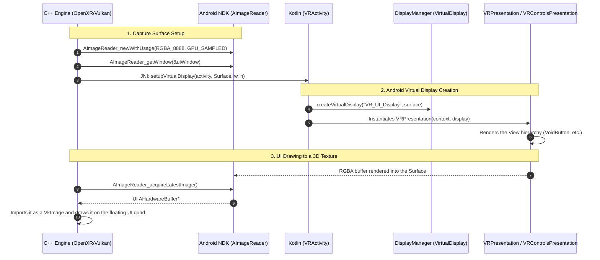
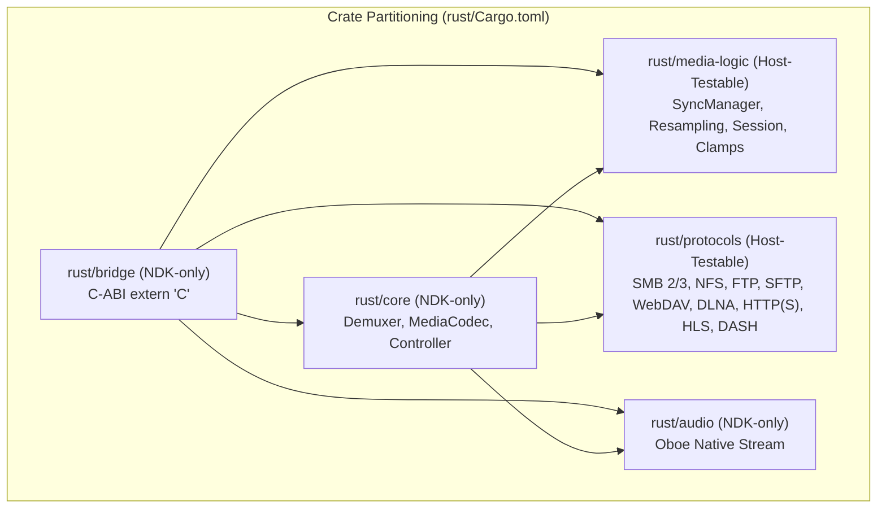
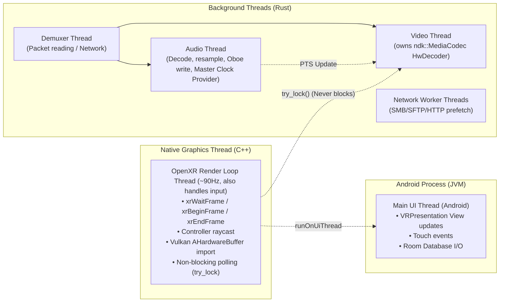
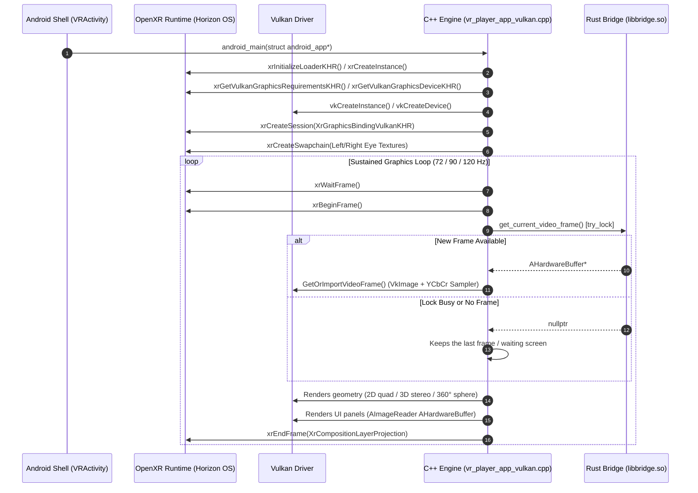
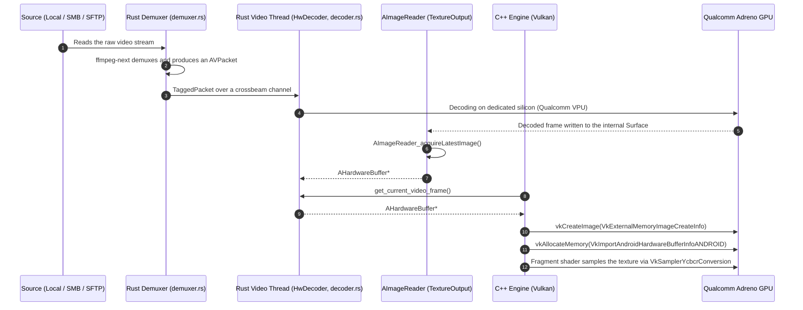
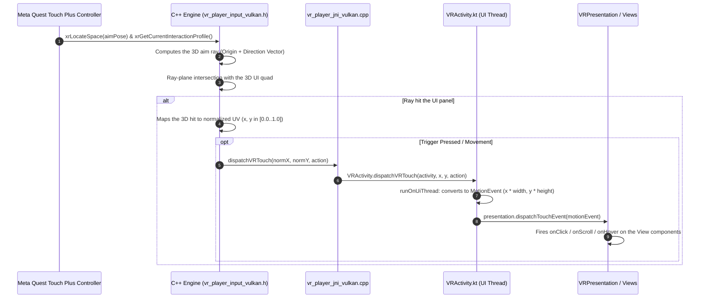
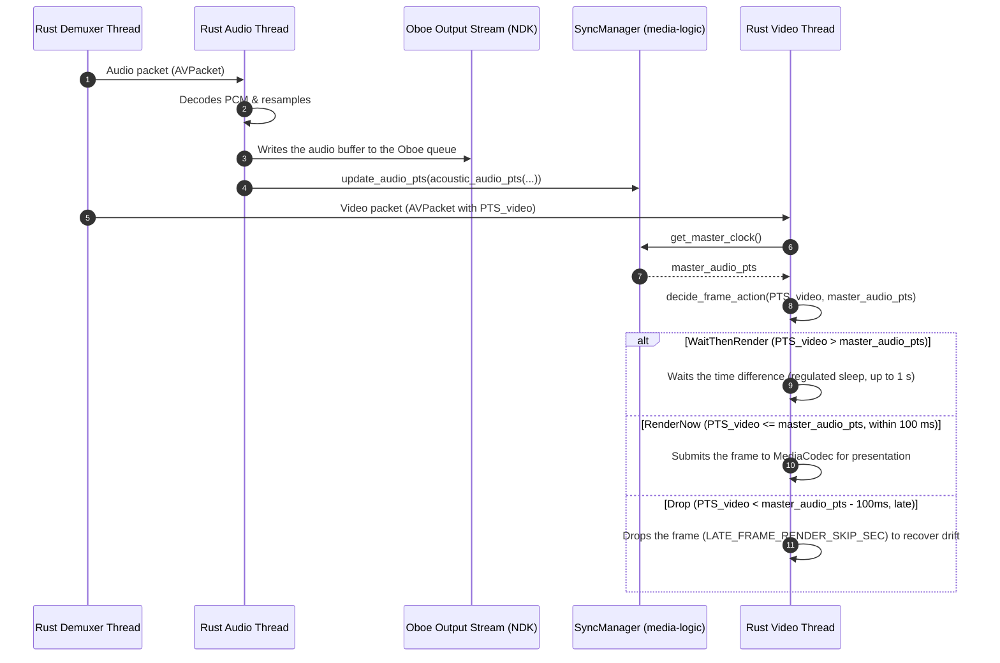

# 📐 System Architecture — tucaVR

> **Canonical Technical Architecture Document**  
> **Primary Platform:** Meta Quest 3 (Qualcomm Snapdragon XR2 Gen 2 / Horizon OS)  
> **Execution Model:** 100% immersive OpenXR (`NativeActivity`, `vr_only`)  
> **Tri-Layer Pattern:** Kotlin (Shell & UI) $\leftrightarrow$ C++ (OpenXR Engine & Vulkan/GLES) $\leftrightarrow$ Rust (Media & Streaming Engine)

---

## 1. Overview and Engineering Goals

**tucaVR** is an immersive video player (2D, stereoscopic 3D SBS/OU, 180° and 360°) designed specifically for standalone headsets based on the Qualcomm Snapdragon XR2 Gen 2 platform (Meta Quest 3).

Unlike traditional mobile Android applications, which overlay flat 2D windows on a VR viewport, tucaVR runs exclusively as a `NativeActivity` in fully immersive mode (`<meta-data android:name="com.oculus.vr.mode" android:value="vr_only" />`). There are no secondary 2D windows or `Activity`s in the process.

```text
┌─────────────────────────────────────────────────────────────────────────────┐
│                           ENGINEERING GOALS                                 │
├─────────────────────────────────────────────────────────────────────────────┤
│  ⚡ Zero-Copy Streaming: direct HW decoder -> GPU VRAM pipeline              │
│  🎯 Sustained 72/90/120 Hz: OpenXR render loop free of I/O blocking          │
│  ⏱️ Strict A/V Sync: audio as master clock with proactive drift correction   │
│  👓 Floating Spatial UI: Android screens rendered onto 3D textures           │
│  🔒 Security and Isolation: encrypted credentials, memory-safe Rust network  │
└─────────────────────────────────────────────────────────────────────────────┘
```

---

## 2. Tri-Layer Topology and FFI Contracts

The system is strictly partitioned into three concentric software layers. Each language is assigned to the zone where it is most efficient:

```mermaid
flowchart TB
    subgraph KOTLIN ["1. Kotlin Layer (app/) — Shell, UI & Persistence"]
        VRActivity["VRActivity (NativeActivity Shell)"]
        VRPres["VRPresentation (screen host: AppNavigator + screens/*)"]
        VRCtrl["VRControlsPresentation (VR Controls Bar)"]
        VRModal["VRModalPresentation (Dialogs and Modals)"]
        VRBrowser["VRWebBrowserPresentation (Compose + GeckoView)"]
        Crypto["EncryptedSharedPreferences (Credentials)"]
        RoomDB["Room DB (Playback History)"]
    end

    subgraph JNI_BOUNDARY ["Bidirectional JNI Boundary"]
        JNI_Calls["• C++ -> Kotlin: setupVirtualDisplay, dispatchVRTouch, runOnUiThread\n• Kotlin -> C++: nativeTogglePlayPause, nativeSeekVideo, nativePlayVideo"]
    end

    subgraph CPP ["2. C++ Layer (native/) — OpenXR Engine & Rendering"]
        XrSession["OpenXR Session & Swapchain Loop (native Vulkan / OVRFW in the GLES fallback)"]
        VkPipeline["Vulkan Render Pipeline (vr_player_app_vulkan.cpp)"]
        GlesPipeline["OpenGL ES Fallback, frozen (vr_player_app.cpp)"]
        Raycast["Raycast Controller Input (vr_player_input_vulkan.h)"]
        UiCapture["AImageReader Capture (UI/Controls/Modals/Browser -> Textures)"]
    end

    subgraph CABI_BOUNDARY ["Flat C-ABI Boundary (extern \"C\")"]
        CABI_Calls["• C++ -> Rust: get_current_video_frame, start_video_playback, seek_video_playback\n• Kotlin NEVER calls Rust directly (ADR-002)"]
    end

    subgraph RUST ["3. Rust Layer (rust/) — Media and Streaming Core"]
        Bridge["rust/bridge (C-ABI libbridge.so)"]
        Demuxer["rust/core::demuxer (ffmpeg-next + Custom I/O)"]
        MediaCodec["rust/core::decoder (ndk::MediaCodec HW Decoder)"]
        SyncMgr["rust/media-logic::sync (SyncManager A/V Clock)"]
        AudioOut["rust/audio (Oboe NDK Low-Latency Audio)"]
        NetClients["rust/protocols (SMB 2/3, NFS, FTP, SFTP, WebDAV, DLNA, HTTP(S), HLS, DASH — pure Rust)"]
    end

    KOTLIN <--> JNI_BOUNDARY
    JNI_BOUNDARY <--> CPP
    CPP <--> CABI_BOUNDARY
    CABI_BOUNDARY <--> RUST
```

### 2.1 Roles and Responsibilities per Layer

| Layer | Language | Main Modules | Responsibility |
| :--- | :--- | :--- | :--- |
| **Shell & UI** | Kotlin | `VRActivity.kt`, `VRPresentation.kt`, `VRControlsPresentation.kt`, `screens/`, `browser/`, `history/` | Android OS orchestration, UI drawing via `VirtualDisplay`, Room persistence, encrypted credentials (`EncryptedSharedPreferences`). |
| **XR Engine** | C++20 | `vr_player_app_vulkan.cpp`, `vr_player_jni_vulkan.cpp`, `vr_player_app.cpp` (frozen GLES fallback) | OpenXR session, swapchains, 72/90/120 Hz draw loop, Touch Plus controller raycasting, `AHardwareBuffer` import into Vulkan/GLES. |
| **Media Core** | Rust (2021 workspace / 2024 protocols) | `core`, `media-logic`, `protocols`, `audio`, `bridge` | Demuxing of local and remote files, hardware-accelerated decoding through NDK `MediaCodec`, audio output with `Oboe`, secure network clients. |

### 2.2 The Critical FFI Rule (ADR-002: Kotlin $\leftrightarrow$ Rust)

> [!IMPORTANT]
> **Kotlin NEVER calls Rust directly.**
> All communication between Kotlin and Rust necessarily goes through the C++ layer.
>
> **Architectural reason:** the C++ render loop fetches the decoded frame pointer (`get_current_video_frame()`) on every headset frame (up to 120 times per second). A direct Kotlin $\leftrightarrow$ Rust call via UniFFI would add needless overhead and detach the synchronization of the graphics render loop from the buffer lifecycle. C++ acts as the real-time conductor between the data decoded by Rust and what is shown in the Quest display.

---

## 3. Graphics and OpenXR Pipeline (Vulkan Primary, GLES Frozen Fallback)

tucaVR's graphics pipeline was migrated to **Vulkan 1.1** as the primary, default backend. A complete **OpenGL ES 3.x** path is kept as a fallback until the Vulkan cut is validated on a headset; it is **frozen**: rendering work goes into the Vulkan path only, and several features (ambient halo, foveation, performance metrics, ADPF, MQSR/SGSR upscaling) exist only there.

```text
                  ┌─────────────────────────────────────┐
                  │    OpenXR Runtime (Horizon OS)      │
                  └──────────────────┬──────────────────┘
                                     │ xrGetVulkanGraphicsRequirementsKHR
                                     ▼
                  ┌─────────────────────────────────────┐
                  │      VkInstance / VkDevice          │
                  │   (Android extensions enabled)      │
                  └───────┬─────────────────────┬───────┘
                          │                     │
          VK_ANDROID_external_memory            │ VK_KHR_sampler_ycbcr_conversion
                          ▼                     ▼
┌───────────────────────────────────┐ ┌───────────────────────────────────┐
│     Imported AHardwareBuffer      │ │  Immutable YCbCr Sampler (GPU)    │
│   (Zero-Copy from NDK MediaCodec) │ │ (Direct color-space conversion)   │
└─────────────────┬─────────────────┘ └─────────────────┬─────────────────┘
                  │                                     │
                  └──────────────────┬──────────────────┘
                                     ▼
                  ┌─────────────────────────────────────┐
                  │   OpenXR Swapchains (Per Eye)       │
                  │  (Stereo Projections / VR Screen)   │
                  └─────────────────────────────────────┘
```

### 3.1 Primary Backend: Vulkan (`vr_player_app_vulkan.cpp`)

1. **Instance and Device Extensions (`CreateVulkanInstanceAndDevice`, `vr_player_app_vulkan.cpp:1449`):** the Vulkan instance and physical device are the ones the OpenXR runtime asks for (`xrGetVulkanGraphicsRequirementsKHR`, `xrGetVulkanInstanceExtensionsKHR`, `xrGetVulkanGraphicsDeviceKHR`, `xrGetVulkanDeviceExtensionsKHR`), plus:
   - **Instance:** `VK_KHR_external_memory_capabilities`, `VK_KHR_get_physical_device_properties2`
   - **Device:** `VK_ANDROID_external_memory_android_hardware_buffer`, `VK_KHR_sampler_ycbcr_conversion`, `VK_KHR_external_memory`, `VK_KHR_dedicated_allocation`, `VK_KHR_bind_memory2`, `VK_KHR_get_memory_requirements2`
2. **Video Buffer Import (`GetOrImportVideoFrame`):**
   - Rust provides the `AHardwareBuffer*` pointer decoded by MediaCodec.
   - C++ queries the memory requirements through `vkGetAndroidHardwareBufferPropertiesANDROID`.
   - It creates a `VkImage` bound with `VkExternalMemoryImageCreateInfo` and format `VK_FORMAT_UNDEFINED` (the decoder hardware manages the raw YUV format).
   - It allocates `VkDeviceMemory` bound with `VkImportAndroidHardwareBufferInfoANDROID` using `VK_MEMORY_PROPERTY_DEVICE_LOCAL_BIT`.
3. **Zero-Overhead YUV $\rightarrow$ RGB Color Conversion:**
   - It uses `VkSamplerYcbcrConversion` so the fragment shader can sample the external `VkImage` directly as RGB through a combined sampler, without requiring multiple GPU shader passes.
4. **Frame Cache (`videoImageCache`):**
   - Android's `MediaCodec` reuses a fixed set of `AHardwareBuffer` instances (an internal pool).
   - C++ keeps a cache indexed by the `AHardwareBuffer*` pointer, avoiding the costly re-creation of `VkImage`s and memory allocations on every frame.
5. **Quest 3 Specific Optimizations:**
   - **Foveated Rendering (`XR_FB_foveation`):** reduces sampling cost in the peripheral vision.
   - **Vulkan Upscaling (MQSR & SGSR1):** super-resolution filters to keep 1080p video sharp when projected onto high-density virtual screens.

### 3.2 Fallback Backend: OpenGL ES (`vr_player_app.cpp`, frozen)

- Uses `eglCreateImageKHR` with `EGL_NATIVE_BUFFER_ANDROID` pointing at the `AHardwareBuffer*`.
- Binds the image with `glEGLImageTargetTexture2DOES` to a `GL_TEXTURE_EXTERNAL_OES` texture.
- Custom OVRFW fragment shaders do the sampling through `samplerExternalOES`.
- Selected at build time with `-PvrplayerGraphicsApi=GLES`; no new rendering features are mirrored into it.

### 3.3 Stereoscopic Projection Modes (`ScreenMode`)

The `ScreenMode` enumeration is synchronized across Rust, C++ and Kotlin (see `native/include/screen_mode.h`, the `SCREEN_MODE` comments and `SCREEN_MODE_COUNT` in `rust/bridge/src/lib.rs`, `ScreenFormatCatalog.kt` and `Format3D::to_screen_mode_index` in `rust/media-logic/src/format3d.rs`):

| ID | Mode (`ScreenModeName`) | Description and Geometry | Per-Eye UV Mapping |
| :--- | :--- | :--- | :--- |
| `0` | `Flat2D` | Floating flat quad panel | Both eyes see the full texture $[0..1, 0..1]$. |
| `1` | `SBS` | Side-by-Side 3D (Full) on a flat quad | Left Eye: $U \in [0.0..0.5]$; Right Eye: $U \in [0.5..1.0]$. |
| `2` | `SBSHalf` | Side-by-Side 3D (Half) on a flat quad | Left Eye: $U \in [0.0..0.5]$; Right Eye: $U \in [0.5..1.0]$. |
| `3` | `OU` | Over/Under 3D (Full) on a flat quad | Left Eye: $V \in [0.0..0.5]$; Right Eye: $V \in [0.5..1.0]$. |
| `4` | `OUHalf` | Over/Under 3D (Half) on a flat quad | Left Eye: $V \in [0.0..0.5]$; Right Eye: $V \in [0.5..1.0]$. |
| `5` | `Sphere360` | Full 360° monoscopic sphere | Equirectangular projection mapped to both eyes. |
| `6` | `Sphere180` | 180° monoscopic hemispherical dome | Spherical coordinates projected identically to both eyes. |
| `7` | `Sphere360SBS` | Full 360° stereo SBS sphere | Equirectangular sphere with a horizontal left/right split. |
| `8` | `Sphere360OU` | Full 360° stereo OU sphere | Equirectangular sphere with a vertical top/bottom split. |
| `9` | `Vr180SBS` | 180° stereo SBS hemispherical dome | 180° hemisphere split horizontally between the left and right eye. |
| `10` | `Cubemap3x2` | 3x2 monoscopic cubemap projection | 6 cube faces laid out in a 3x2 grid. |
| `11` | `Cubemap6x1` | 6x1 monoscopic cubemap projection | 6 cube faces in a continuous horizontal strip. |
| `12` | `EAC3x2` | 3x2 Equi-Angular Cubemap (EAC), mono | 3x2 angular pixel-density optimization. |
| `13` | `Cubemap3x2SBS` | 3x2 stereo SBS cubemap | Stereo cubemap split into left and right halves. |
| `14` | `EAC3x2SBS` | 3x2 stereo SBS EAC | Stereo Equi-Angular Cubemap with a horizontal split. |
| `15` | `Fisheye190` | 190° monoscopic fisheye projection | Ultra-wide monoscopic hemispherical field of view. |
| `16` | `Fisheye190SBS` | 190° stereo SBS fisheye projection | 190° side-by-side stereo field of view. |

---

## 4. User Interface Pipeline (VirtualDisplay & Presentation)

To provide a rich, dynamic and consistent user interface on the Quest without breaking the `NativeActivity vr_only` mode, tucaVR renders standard Android interfaces directly into operating-system-managed `VirtualDisplay`s. The main panels use classic Views (`com.tucavr.designsystem`); the in-app web browser panel uses Jetpack Compose hosting a GeckoView.



### 4.1 Quadruple UI Surface

The system allocates four simultaneous, independent `VirtualDisplay`s (see the constants in `native/src/vr_player_app_vulkan.cpp`; `VRActivity.kt` calls `createVirtualDisplay` once per surface):

1. **Main UI Canvas (`virtualDisplay`):** `kUiTexWidth = 1920`, `kUiTexHeight = 960`, managed by `VRPresentation`. Projected onto an OpenXR cylinder layer (`XrCompositionLayerCylinderKHR`) with configurable radius (1.3m, 1.6m, 2.0m) and central angle / horizontal FOV (50°, 80°, 100°). The 1920x960 surface is partitioned into 3 simultaneous zones:
   - **Zone 1: Sidebar (288px):** Persistent navigation rail (Home, Local Files, Network, Playlists, History, Settings).
   - **Zone 2: Content (1200px):** Primary browsing viewport (file lists/grids, server catalogs, settings option categories).
   - **Zone 3: Context Rail (432px):** Dynamic context pane (selected file details with metadata/preview, live telemetry preview rail in settings, direct action buttons). Single tap on a file selects and populates Zone 3; a second tap or the Play button in Zone 3 begins playback directly.
2. **Playback Controls Bar (`controlsVirtualDisplay`):** `kControlsTexWidth = 1582`, `kControlsTexHeight = 800`, managed by `VRControlsPresentation`. A floating curved bar below the screen with Play/Pause, seek bar, volume, audio/subtitle selectors, and Stats for Nerds 3-state cycle toggle.
3. **Modals, Dialogs & Docked Stats (`modalVirtualDisplay`):** `kModalTexWidth = 1024`, `kModalTexHeight = 768`, managed by `VRModalPresentation`. Floating quad for confirmation dialogs, resume prompts ("Retomar de XX:XX?"), and docked Stats for Nerds. In docked mode, the panel is positioned at radius 2.4m at an azimuth of ~38° to the right of the video screen, oriented with yaw facing $(0, y, 0)$ directly toward the viewer.
4. **In-app Web Browser (browser `VirtualDisplay`):** `kBrowserTexWidth = 2560`, `kBrowserTexHeight = 1440`, managed by `VRWebBrowserPresentation` (Jetpack Compose + GeckoView, in `browser/`).

### 4.2 Interaction and Touch Synthesis (Controller Raycasting)

Interaction with the UI follows a real-time geometric precision pipeline:

1. C++ obtains the 6DoF pose of the right/left Touch Plus controller through `xrLocateSpace`.
2. It projects a geometric laser ray $\vec{R}(t) = \vec{O} + t \cdot \vec{D}$ into 3D space.
3. It performs geometric intersection testing:
   - **Cylindrical Canvas:** Uses `rayHitsCylinder` (`native/include/cylinder_hit.h` and `vr_player_input_vulkan.h`), solving the ray-cylinder quadratic equation for radius $R$ and angular span $[-\theta/2, +\theta/2]$, mapping intersections to UV coordinates $u = 0.5 - \text{atan2}(x, -z)/\text{centralAngle}$ and $v = 0.5 - y / \text{height}$.
   - **Planar Quads:** Uses `rayHitsQuad` for the floating playback controls, browser, and modal panels (including azimuth-rotated docked stats quad at $+38^\circ$).
4. Converts the three-dimensional hit point into normalized UV coordinates $x, y \in [0.0, 1.0]$.
5. **Haptic Feedback:** When a controller ray enters a clickable element or interactive surface, optional hover haptics (`HOVER_HAPTICS`) emit a subtle 15ms pulse (amplitude 0.15).
6. **Physical Back Controls:** The secondary B/Y controller buttons synthesize Back events when enabled (`BY_BUTTON_AS_BACK`), routed to the active presentation or navigation stack.
7. If there is a hit and the user pulls the trigger, C++ invokes through JNI:

   ```kotlin
   VRActivity.dispatchVRTouch(activity, targetDisplay, normX, normY, action)
   ```

8. The Kotlin method runs on the UI thread (`runOnUiThread`), scales the coordinates to the virtual display resolution (`normX * UI_WIDTH`, `normY * UI_HEIGHT`), creates a genuine `android.view.MotionEvent` (`ACTION_DOWN`, `ACTION_MOVE`, `ACTION_UP` or `ACTION_HOVER_MOVE`) and dispatches it directly to `presentation.dispatchTouchEvent(event)`.

---

## 5. Media Pipeline and A/V Synchronization (Rust Engine)

The Rust layer is split into modular crates so unit tests can run on the host (laptop/CI development) without Android NDK dependencies.



### 5.1 Zero-Copy Video Pipeline

```text
┌─────────────────┐     ┌─────────────────┐     ┌───────────────────┐     ┌──────────────────┐
│ Network Source  │     │  Rust Demuxer   │     │ MediaCodec HW NDK │     │   ImageReader    │
│ or Local        │ ──> │ (ffmpeg-next)   │ ──> │ (H.264/HEVC/AV1)  │ ──> │  (NDK Surface)   │
└─────────────────┘     └─────────────────┘     └───────────────────┘     └─────────┬────────┘
                                                                                    │
                                      AHardwareBuffer* Pointer (Zero-Copy)          ▼
┌─────────────────┐     ┌─────────────────┐     ┌───────────────────┐     ┌──────────────────┐
│  VR Eyes on     │ <── │ Fragment Shader │ <── │  VkSamplerYcbcr   │ <── │ Imported VkImage │
│  Meta Quest 3   │     │ (Sampled RGB)   │     │    Conversion     │     │ (Vulkan Memory)  │
└─────────────────┘     └─────────────────┘     └───────────────────┘     └──────────────────┘
```

1. The **Demuxer** (`demuxer.rs`) consumes data from local files or custom Rust I/O channels (`protocols`).
2. Compressed video packets are tagged with the current generation epoch (`TaggedPacket { epoch, packet }`) and sent over bounded crossbeam channels (capacity 300) to the video thread, which owns the `HwDecoder`.
3. The **`ndk::MediaCodec`** decoder decodes the packets directly into a native Android surface bound to an `AImageReader`.
4. The `AImageReader` retains the output buffers as opaque `AHardwareBuffer*` pointers.
5. C++ obtains the pointer through `get_current_video_frame()` and maps it directly into the Vulkan GPU via `VkImportAndroidHardwareBufferInfoANDROID`, without a single pixel byte passing through the CPU.

### 5.2 A/V Sync and Master Clock (`SyncManager`)

Audio and video synchronization is governed by the `SyncManager` class (`rust/media-logic/src/sync.rs`):

- **Audio as Master Clock:** the Rust audio decode thread reports the PTS (*Presentation Time Stamp*) of the audio actually being heard, computed by `acoustic_audio_pts(...)` (the PTS written to the Oboe queue minus the delay of the samples still queued), through `update_audio_pts(pts)`.
- **Wall-Clock Fallback:** if the video has no audio track, or during initial buffering before the first audio packet, the master clock uses a monotonic system clock with speed-scale compensation (`start_time.elapsed() * speed`).
- **Drop and Catch-Up Policies (Drift Compensation):**
  - **`LATE_FRAME_RENDER_SKIP_SEC` ($0.10\text{s} = 100\text{ms}$):** if a decoded frame arrives more than 100 ms late relative to the audio, it is dropped at presentation time so it does not delay the render loop.
  - **`CATCH_UP_SKIP_THRESHOLD_SEC` ($0.50\text{s} = 500\text{ms}$):** if the accumulated delay exceeds half a second (for example a network latency spike or a decoder bottleneck at 2x), non-key video packets (B/P frames) are summarily dropped **before** decoding until the next keyframe (I frame).
- **Frame presentation decision:** the video thread calls `media_logic::frame_timing::decide_frame_action`, which returns `Land` (first frame after a seek, shown immediately), `WaitThenRender(duration)` (frame is early, wait up to 1 s in short slices), `RenderNow` (on time or late within the tolerance) or `Drop` (too late to be worth showing).

---

## 6. Thread Model, Concurrency and Non-Blocking Behavior

Framerate stability in Virtual Reality is mandatory to prevent motion sickness. For this reason the architecture enforces a strict thread separation and a non-blocking synchronization policy in the graphics loop.



Rust playback spawns exactly three threads: demux, video and audio. The `HwDecoder` is moved wholesale into the video thread (`rust/core/src/playback.rs`, `rust/core/src/decoder.rs`); there is no separate decoder or sync thread.

### 6.1 The Golden `try_lock()` Rule in the Render Loop

In the C-ABI bridge (`rust/bridge/src/lib.rs`):

```rust
#[no_mangle]
pub extern "C" fn get_current_video_frame() -> *mut c_void {
    match CONTROLLER.try_lock() {
        Ok(controller) => controller.get_current_frame(),
        Err(_) => std::ptr::null_mut(),
    }
}
```

> [!CAUTION]
> The C++ OpenXR render loop **must never block on a mutex**.
> Heavy operations such as opening remote files over SFTP/SMB or searching for keyframes (`seek`) hold the `PlaybackController` mutex for hundreds of milliseconds. If `get_current_video_frame()` used a blocking `lock()`, the headset would freeze rendering and head tracking, causing instant nausea for the user. With `try_lock()`, if there is temporary contention the function returns `null` and C++ simply repeats the last frame or renders the waiting black screen, keeping the headset at a rock-solid 90 FPS.

### 6.2 Error Ring Buffer (`ErrorRingBuffer`)

I/O failures on secondary Rust threads must not raise exceptions or panic the process. The `media-logic` crate implements the `ErrorRingBuffer`, which atomically stores the most recent errors (16 entries). The Kotlin layer periodically drains this queue through lightweight JNI polling (`VRActivity.nativeTakeLastPlaybackError()`, respecting the ADR-002 isolation where Kotlin never touches Rust directly) and shows Toasts in the interface without any blocking synchronization.

---

## 7. Lifecycle and Focus Management (Horizon OS & ADR-006)

The lifecycle of a VR application on Horizon OS differs critically from that of a phone's Android Activity.

### 7.1 OpenXR Event-Driven Auto-Pause

The application is configured in `AndroidManifest.xml` with:

```xml
<meta-data android:name="com.oculus.vr.focusaware" android:value="true" />
```

- **Why `Activity.onPause()` is not reliable in VR:** when the user presses the Oculus/Horizon button and opens the system menu or enables Passthrough, the application stays visible in the background. Android does **not** send `onPause()` to an Activity marked `focusaware`.
- **Architectural Decision (ADR-006):** pause and resume are dictated strictly by the OpenXR session state machine processed in C++ (`vr_player_app_vulkan.cpp`, session-state event handler):
  - `XR_SESSION_STATE_STOPPING`: calls `on_app_focus_lost()` (pausing the decoders and audio) **before** `xrEndSession`.
  - `XR_SESSION_STATE_LOSS_PENDING` / `XR_SESSION_STATE_EXITING`: request the app to exit (`requestExit`), with no pause.
  - `XR_SESSION_STATE_FOCUSED`: calls `on_app_focus_gained()`, resuming playback if the user was watching before the interruption.
  - `Activity.onDestroy()`: reserved solely for the definitive destruction of surfaces, release of sockets and process teardown. `VRActivity.onPause()` only flushes the playback-history progress.

---

## 8. Security and Data Persistence

### 8.1 Encrypted Storage of Network Credentials

SMB, FTP and SFTP servers require secure storage of passwords and SSH private keys.

- tucaVR uses the `androidx.security:security-crypto` library (`EncryptedSharedPreferences`) through the `SmbCredentialStore`, `FtpCredentialStore` and `SftpCredentialStore` classes.
- The encryption keys are managed directly by the **hardware-backed Android Keystore** of the Snapdragon XR2 processor.
- No password or private key is written to plain-text files or exposed in logcat logs.

### 8.2 History and Favorites (Room Database)

Video progress and library persistence are handled by the **Android Room DB** (`AppDatabase`, `@Database` in `history/AppDatabase.kt:33`), using KSP for code generation.

- Progress updates are throttled so they do not overload the headset's flash storage during continuous playback.

---

## 9. Detailed Sequence Diagrams

### 9.1 Initialization and the OpenXR Vulkan Render Loop



### 9.2 Zero-Copy Video Pipeline (Demux $\rightarrow$ MediaCodec $\rightarrow$ Vulkan)



### 9.3 UI Interaction by Raycast and Touch Dispatch



### 9.4 A/V Sync (Audio Clock Master vs Video Frame Presentation)



---

## 10. References and Related Documents

For complementary details on specific tucaVR subsystems:

- **[docs/REQUIREMENTS.md](REQUIREMENTS.md):** business requirements, phase prioritization and the historical ADR log (ADR-001 to ADR-006).
- **[docs/VULKAN-MIGRATION-PLAN.md](VULKAN-MIGRATION-PLAN.md):** detailed architecture of the graphics pipeline transition from GLES to Vulkan.
- **[docs/TESTING-PLAN.md](TESTING-PLAN.md):** strategy for isolating host unit tests, Docker network-protocol tests and real-hardware tests.
- **[docs/DEBUGGING.md](DEBUGGING.md):** on-device debugging guide, ADB commands, VR HUD overlay and playback metrics inspection.
- **[docs/NETWORK-IO-PERFORMANCE.md](NETWORK-IO-PERFORMANCE.md):** analysis of streaming buffers and network prefetcher behavior.
