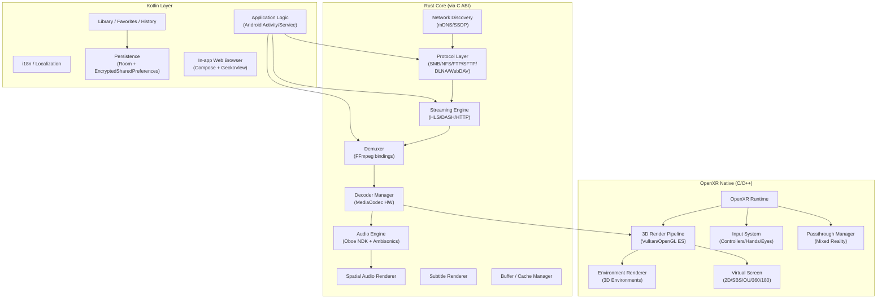

# 🥽 tucaVR — Requirements Document (v0.5)

> **Project**: 2D/3D Multimedia Player for Virtual Reality  
> **Stack**: Kotlin + Rust + native OpenXR (C/C++ for rendering)  
> **Primary Platform**: Meta Quest 3 (Qualcomm XR2 Gen 2)  
> **License**: MIT  
> **Initial Use**: Personal (possible publication on the Meta Quest Store in the future)  
> **Status**: 🟢 Consolidated Architecture — Phases v0.1 to v0.5 implemented (v0.5 partially; Phase 0.6 stabilization in progress)

---

## 1. Overview

Open source immersive multimedia player for virtual reality headsets. It combines:

- **Kotlin** for application logic, network management, persistence and high-level UI
- **Rust** for the performance core (decoding, streaming, network protocols)
- **Native OpenXR (C/C++)** for rendering the VR environments and the graphics pipeline

The focus is playback of 2D and 3D content with robust support for network protocols for NAS and media servers.

---

## 2. High-Level Architecture

---

## 3. Functional Requirements

### 3.1 2D Media Playback

| ID | Requirement | Priority | Phase |
|----|-------------|----------|-------|
| RF-2D-001 | Play 2D videos on a flat virtual screen in VR space | 🔴 Critical | v0.1 |
| RF-2D-002 | Containers: MP4, MKV, AVI, MOV, WebM, FLV, TS | 🔴 Critical | v0.1 |
| RF-2D-003 | Video codecs: H.264, H.265/HEVC (HW decode mandatory) | 🔴 Critical | v0.1 |
| RF-2D-004 | Video codecs: VP9, AV1 (HW decode when available) | 🟡 Medium | v0.3 |
| RF-2D-005 | Audio codecs: AAC, MP3, FLAC, Opus, AC3, DTS, TrueHD | 🔴 Critical | v0.1 |
| RF-2D-006 | External subtitles: SRT, SSA/ASS, VTT | 🟡 Medium | v0.2 |
| RF-2D-007 | Embedded subtitles (MKV, MP4) + PGS bitmap | 🟡 Medium | v0.3 |
| RF-2D-008 | Freely resize and reposition the virtual screen in 3D space | 🔴 Critical | v0.1 |
| RF-2D-009 | Multiple simultaneous virtual screens | 🟢 Low | v0.5 / v0.6 (2 screens; the full 3-screen scope is deferred to post-1.0) |
| RF-2D-010 | Display images (JPEG, PNG, WebP, AVIF, RAW) | 🟡 Medium | v0.3 |
| RF-2D-011 | Play standalone audio (music, podcasts) | 🟡 Medium | v0.3 |

### 3.2 3D / VR Media Playback

| ID | Requirement | Priority | Phase |
|----|-------------|----------|-------|
| RF-3D-001 | Side-by-Side (SBS) 3D video — half and full | 🔴 Critical | v0.1 |
| RF-3D-002 | Over/Under (OU) 3D video — half and full | 🔴 Critical | v0.1 |
| RF-3D-003 | Monoscopic 360° video (equirectangular) | 🔴 Critical | v0.2 |
| RF-3D-004 | Stereoscopic 360° video (SBS/OU equirectangular) | 🔴 Critical | v0.2 |
| RF-3D-005 | 180° VR video (VR180) | 🔴 Critical | v0.2 |
| RF-3D-006 | Support for resolutions up to 8K for VR content | 🟡 Medium | v0.4 |
| RF-3D-007 | Projections: Equirectangular, Cubemap, EAC (Equi-Angular Cubemap) | 🟡 Medium | v0.4 |
| RF-3D-008 | 360° photos and 3D photos (SBS/OU) | 🟡 Medium | v0.3 |
| RF-3D-009 | Ambisonics spatial audio (1st and 2nd order) | 🟡 Medium | v0.3 |
| RF-3D-010 | Virtualized 5.1 and 7.1 multichannel audio | 🟡 Medium | v0.3 |
| RF-3D-011 | Head tracking with latency < 20ms for 360° content | 🔴 Critical | v0.2 |
| RF-3D-012 | Automatic 3D format detection by metadata, filename, or heuristic | 🔴 Critical | v0.2 |

### 3.3 Network Protocols / NAS

| ID | Requirement | Priority | Phase |
|----|-------------|----------|-------|
| RF-NET-001 | **SMB/CIFS** — Browse and play from Windows shares / NAS | 🔴 Critical | v0.1 |
| RF-NET-002 | **NFS** — Browse and play from NFS exports | 🟡 Medium | v0.2 |
| RF-NET-003 | **FTP** — Connect to and browse FTP servers | 🟡 Medium | v0.2 |
| RF-NET-004 | **SFTP** — Connect over secure SSH/SFTP | 🟡 Medium | v0.2 |
| RF-NET-005 | **DLNA/UPnP** — Automatic discovery and browsing | 🔴 Critical | v0.2 |
| RF-NET-006 | **WebDAV** — Connect to WebDAV servers | 🟢 Low | v0.4 |
| RF-NET-007 | **HTTP/HTTPS** — Play from direct URLs | 🔴 Critical | v0.1 |
| RF-NET-008 | **HLS** — HTTP Live Streaming | 🔴 Critical | v0.2 |
| RF-NET-009 | **DASH** — Dynamic Adaptive Streaming | 🟡 Medium | v0.3 |
| RF-NET-010 | Automatic server discovery (mDNS/SSDP/NetBIOS) | 🔴 Critical | v0.2 |
| RF-NET-011 | Saved connection management (server favorites) | 🔴 Critical | v0.2 |
| RF-NET-012 | Adaptive cache/buffer for network streaming | 🔴 Critical | v0.1 |

> RF-NET-010: mDNS and SSDP discovery are implemented (`rust/protocols/src/discovery/`); NetBIOS name discovery is **not** implemented yet.

### 3.4 VR User Interface

| ID | Requirement | Priority | Phase |
|----|-------------|----------|-------|
| RF-UI-001 | Immersive main menu in a 3D environment | 🔴 Critical | v0.1 |
| RF-UI-002 | Floating playback controls (play/pause/seek/volume/track) | 🔴 Critical | v0.1 |
| RF-UI-003 | File browser with hierarchical navigation (local + network) | 🔴 Critical | v0.1 |
| RF-UI-004 | **Interaction via Quest 3 controllers** (raycasting + buttons) | 🔴 Critical | v0.1 |
| RF-UI-005 | **Hand Tracking** — natural gestures to control the UI | 🟡 Medium | v0.3 |
| RF-UI-006 | **Eye Tracking** — gaze selection + foveated UI | 🟢 Low | post-1.0 (descoped from v1; see §9) |
| RF-UI-007 | Virtual keyboard for URLs, passwords, searches | 🔴 Critical | v0.1 |
| RF-UI-008 | Metadata display (title, duration, resolution, codec, cover) | 🟡 Medium | v0.2 |
| RF-UI-009 | Gaze-based UI as a fallback (no controller) | 🟡 Medium | v0.4 |
| RF-UI-010 | Dark theme optimized for VR (low brightness for comfort) | 🔴 Critical | v0.1 |

### 3.5 Virtual Environments

| ID | Requirement | Priority | Phase |
|----|-------------|----------|-------|
| RF-ENV-001 | **Void/Dark** — Minimalist dark environment with a floating screen | 🔴 Critical | v0.1 |
| RF-ENV-002 | **Cinema** — Virtual movie theater with a large screen | 🟡 Medium | v0.3 |
| RF-ENV-003 | **Living Room** — Home environment with a virtual TV | 🟡 Medium | v0.3 |
| RF-ENV-004 | **Space** — Cosmic/space environment | 🟢 Low | v0.5 |
| RF-ENV-005 | User-customizable environments (import 3D models) | 🟢 Low | v1.0 |
| RF-ENV-006 | **Passthrough/Mixed Reality** — Floating screen over the real world | 🟡 Medium | v0.3 |
| RF-ENV-007 | Environment lighting and color adjustment | 🟢 Low | v0.5 |

### 3.6 Content Management

| ID | Requirement | Priority | Phase |
|----|-------------|----------|-------|
| RF-LIB-001 | Local library with automatic folder scanning | 🔴 Critical | v0.1 |
| RF-LIB-002 | Playback history with resume position | 🔴 Critical | v0.1 |
| RF-LIB-003 | Custom playlists | 🟡 Medium | v0.3 |
| RF-LIB-004 | Search and filters (by name, type, date, format) | 🟡 Medium | v0.2 |
| RF-LIB-005 | Favorites/bookmarks for files and servers | 🟡 Medium | v0.2 |
| RF-LIB-006 | Download media for offline playback | 🟡 Medium | v0.4 |

### 3.7 Internationalization (i18n)

| ID | Requirement | Priority | Phase |
|----|-------------|----------|-------|
| RF-I18N-001 | i18n system with resource bundles from the start | 🔴 Critical | v0.1 |
| RF-I18N-002 | Portuguese (BR) as the default language | 🔴 Critical | v0.1 |
| RF-I18N-003 | Complete English | 🔴 Critical | v0.1 |
| RF-I18N-004 | Spanish | 🟡 Medium | v0.3 |
| RF-I18N-005 | Translation contribution system (community) | 🟢 Low | v1.0 |

> RF-I18N-001/002/003 were implemented in v0.1 (see `docs/phases/PHASE-0.1-MVP.md`,
> section 8, T8.1-T8.5). The complete process (naming convention, how to add a new
> language, the finding about the C++ layer) is documented in `docs/i18n.md`.
> Note on RF-I18N-002 ("Portuguese BR as the default language"): the `res/values/`
> folder (the Android resource system's default/fallback) contains **English**, with
> `res/values-pt-rBR/` as the specific override. This is the standard Android
> convention (universal fallback + regional override) and is what T8.1/T8.2 explicitly
> ask for; "default language" here was interpreted as "the language the product was
> first conceived/tested in", not as "the content of the folder with no qualifier".

---

## 4. Non-Functional Requirements

### 4.1 Performance

| ID | Requirement | Target | Phase |
|----|-------------|--------|-------|
| RNF-PERF-001 | Constant FPS in VR rendering | ≥ 72 FPS (ideally 90 FPS) | v0.1 |
| RNF-PERF-002 | Motion-to-photon latency for 360° | < 20ms | v0.2 |
| RNF-PERF-003 | Playback start time | < 2s (local), < 5s (network) | v0.1 |
| RNF-PERF-004 | RAM usage | < 2.5GB | v0.1 |
| RNF-PERF-005 | Hardware decoding via MediaCodec | Mandatory | v0.1 |
| RNF-PERF-006 | Thermal throttling monitoring and reaction | Mandatory | v0.2 |
| RNF-PERF-007 | Adaptive quality (downscale if overheating) | Mandatory | v0.3 |
| RNF-PERF-008 | Foveated rendering for environments (GPU savings) | Recommended | v0.4 |

### 4.2 Compatibility

| ID | Requirement | Type |
|----|-------------|------|
| RNF-COMP-001 | Meta Quest 3 | ✅ Primary |
| RNF-COMP-002 | Meta Quest 3S | ✅ Supported (the manifest allows `quest3\|quest3s`) |
| RNF-COMP-003 | Meta Quest Pro | ⚪ Not supported (excluded by `com.oculus.supportedDevices`) |
| RNF-COMP-004 | Meta Quest 2 | ⚪ Not supported (excluded by `com.oculus.supportedDevices`) |
| RNF-COMP-005 | Future Android XR / OpenXR headsets | 📋 Planned |
| RNF-COMP-006 | OpenXR 1.0+ runtime | Mandatory |
| RNF-COMP-007 | Android API 26+ (Android 8.0 Oreo, minSdk = 26) | Mandatory |
| RNF-COMP-008 | Vulkan 1.1+ (default backend) or OpenGL ES 3.x (frozen fallback) | Mandatory |

### 4.3 Security

| ID | Requirement | Priority |
|----|-------------|----------|
| RNF-SEC-001 | Encrypted server credentials (AES-256 + Android Keystore) | 🔴 Critical |
| RNF-SEC-002 | TLS/SSL for all network connections | 🔴 Critical |
| RNF-SEC-003 | No telemetry / analytics (open source, personal use) | 🔴 Critical |
| RNF-SEC-004 | SSL certificate validation (with an option to accept self-signed) | 🟡 Medium |

### 4.4 Code Quality

| ID | Requirement | Target |
|----|-------------|--------|
| RNF-QUAL-001 | Rust core unit tests | ≥ 80% coverage |
| RNF-QUAL-002 | Kotlin ↔ Rust (JNI) integration tests | Mandatory |
| RNF-QUAL-003 | CI/CD (GitHub Actions) | Automatic build + test |
| RNF-QUAL-004 | Linting: `clippy` (Rust) + `ktlint` (Kotlin) | Mandatory |
| RNF-QUAL-005 | Public API documentation | Mandatory |
| RNF-QUAL-006 | Structured logging (levels: trace/debug/info/warn/error) | Mandatory |

> RNF-QUAL-002 is not met yet: there is no `app/src/androidTest` and the JNI boundary has no
> automated test. Current coverage is host-only (Rust, C++ and JVM), see `docs/TESTING-PLAN.md`.

---

## 5. Defined Technology Stack

### 5.1 Kotlin Layer (Android Application)

| Component | Technology | Rationale |
|-----------|------------|-----------|
| Build system | Gradle (AGP) + KTS | Android standard |
| DI | Manual injection (Koin discarded, see §5.5) | Simple, direct graph, with no reflection/runtime overhead |
| Persistence | Room + EncryptedSharedPreferences (DataStore discarded, see §5.5) | Typed SQLite with KSP for history/servers; Keystore for credentials |
| Network discovery | Rust mDNS (`mdns-sd`) + SSDP in `protocols::discovery`, called through the bridge (Ktor discarded, see §5.5) | Pure Rust, no Kotlin networking layer |
| UI | Android `View`s (main panels) + Jetpack Compose (BOM 2023.10.01) for the web browser panel | Rendered in `Presentation`s on `VirtualDisplay`s (see `docs/ARCHITECTURE.md` §4) |
| Web browser | GeckoView (`geckoview-omni`) | Off-screen rendering and Widevine support for the in-app browser |
| i18n | Android Resources (strings.xml) | Android standard, PT-BR, EN and ES support |
| Rust interop | Indirect through C++ (JNI → C++ → Rust C ABI) | Kotlin never calls Rust directly (see ADR-002) |

### 5.2 Rust Core (Performance)

| Component | Technology | Rationale |
|-----------|------------|-----------|
| Demuxing | `ffmpeg-next` (FFmpeg bindings) | Universal container/codec support |
| HW Decode | Android MediaCodec (via NDK) | Hardware decoding on the XR2 |
| Audio | `oboe` (Google Oboe NDK) | Low latency on Android |
| Ambisonics | Native spatial audio (`media-logic::spatial_audio`) | Spatial channel support and downmix |
| Streaming | `reqwest` + `tokio` | Async HTTP/HLS/DASH |
| SMB | `smb2` crate | Windows/NAS shares |
| NFS | `protocols::nfs` | NFS shares |
| FTP/SFTP | `suppaftp` + `russh`/`russh-sftp` | File transfer and streaming |
| DLNA/UPnP | Pure client in `protocols::dlna` (`rupnp` discarded, see §5.5) | Pure SSDP discovery and SOAP control |
| WebDAV | `reqwest` + custom DAV parser | WebDAV protocol for streaming and browsing |
| Subtitles | `subtitle_loader.rs` via FFmpeg + ASS parser (`subparse` discarded, see §5.5) | Embedded and external SRT/VTT/ASS subtitles |
| Async runtime | `tokio` | Async I/O |
| Build target | `aarch64-linux-android` | Quest 3 ARM64 |
| C ABI bridge | `extern "C"` in `rust/bridge/` | C++↔Rust interface (see ADR-002) |

### 5.3 OpenXR / C++ Layer (VR Rendering)

| Component | Technology | Rationale |
|-----------|------------|-----------|
| VR Runtime | OpenXR 1.0 (Meta OpenXR loader) | Industry standard |
| Graphics API | Vulkan 1.1 (default, via migration — see ADR-003) | Fine pipeline control, future compute shaders |
| Fallback | OpenGL ES 3.x (via OVRFW, `-PvrplayerGraphicsApi=GLES`), frozen | Kept as an alternative path until the Vulkan cut is validated on a headset |
| Passthrough | Meta Passthrough API (XR extension) | Mixed reality |
| Hand tracking | XR_EXT_hand_tracking | Natural gestures |
| Eye tracking | XR_EXT_eye_gaze_interaction (descoped from v1 — deferred to post-1.0, see §9) | Gaze-driven UI |
| Environment | Custom meshes + skyboxes | 3D environments |
| Shader lang | GLSL → SPIR-V (Vulkan, via `glslc`) / GLSL (GLES fallback) | Shaders in `native/shaders/vulkan/` |
| Math | In-house `native/include/vk_math.h` (Vulkan); `OVR::` from SampleXrFramework only in the GLES fallback (`glm` discarded, see §5.5) | Math primitives with no external dependency |

### 5.4 Build & Tooling

| Component | Technology |
|-----------|------------|
| Monorepo | Cargo workspace + Gradle modules |
| Rust → Android | `cargo-ndk` |
| Cross-compile | Android NDK r26+ |
| CI/CD | GitHub Actions |
| Linting | `clippy` + `ktlint` + `clang-format` + `markdownlint` (`clang-tidy` discarded, see §5.5) |
| Docs | Canonical Markdown in the repo (`docs/`) (`dokka` discarded, see §5.5) |

### 5.5 Libraries Evaluated and Discarded

During the project's development, several libraries that had been preliminarily considered were evaluated and discarded in favor of leaner, safer approaches that fit the tri-layer architecture:

| Library | Layer | Decision | Technical Rationale |
|---------|-------|----------|---------------------|
| **Koin** | Kotlin | Discarded | Manual, direct dependency injection was adopted; the app's graph is simple and explicit, dispensing with the reflection and runtime-initialization overhead of a DI framework. |
| **DataStore** | Kotlin | Discarded | Room DB (with versioned, typed migrations via KSP) serves structured data (history, servers) perfectly, while `EncryptedSharedPreferences` serves secrets with the hardware Keystore. |
| **Ktor Client** | Kotlin | Discarded | Media networking is 100% handled in Rust (`protocols`), and LAN discovery uses mDNS and SSDP implemented in Rust, making an asynchronous HTTP client in Kotlin redundant. |
| **glm** | C++ | Discarded | The Vulkan backend (default, without OVRFW) uses the in-house `native/include/vk_math.h`; only the frozen GLES fallback uses the `OVR::Matrix4f`/`OVR::Vector3f` primitives of SampleXrFramework. Neither path needs an external dependency. |
| **rupnp** | Rust | Discarded | A lean, pure SSDP/SOAP implementation in `rust/protocols/src/dlna/`, avoiding heavy dependencies and allowing direct integration with the player's streaming pipeline. |
| **subparse** | Rust | Discarded | FFmpeg (`ffmpeg-next`) already extracts subtitle packets and metadata, complemented by the in-house ASS/SSA parser in `rust/media-logic/src/subtitle_ass.rs` (called from `rust/core/src/subtitle_loader.rs`). |
| **clang-tidy** | C++ / Tooling | Discarded | To keep CI fast and deterministic, native static analysis relies on `clang-format --dry-run -Werror` and strict C++20 compiler flags (`-Wall -Wextra`). |
| **dokka** | Kotlin / Docs | Discarded | Documentation is kept as a living canonical source in Markdown directly in the repository (`docs/`), avoiding slow Gradle plugins and unnecessary build complexity. |

---

## 6. Development Phases (Roadmap)

### v0.1 — MVP (Foundation)

> Play a local 2D video on a virtual screen on the Quest 3

- [x] Monorepo setup (Kotlin + Rust + C++)
- [x] Basic pipeline: demux → decode (HW) → render on a quad
- [x] Void environment (floating screen on a dark background)
- [x] Basic controls (play/pause/seek) via controllers
- [x] Local file browser (Quest storage)
- [x] Basic SMB (browse and play from a NAS)
- [x] HTTP URL playback
- [x] i18n setup (PT-BR + EN)
- [x] Playback history

### v0.2 — 3D & Network

> 3D content and network integration

- [x] SBS / Over-Under / 360° / 180° playback
- [x] Automatic 3D format detection
- [x] Head tracking for 360° content
- [x] DLNA/UPnP discovery
- [x] NFS, FTP, SFTP
- [x] HLS streaming
- [x] Subtitles (SRT, VTT)
- [x] Library search and filters
- [x] Thermal monitoring

### v0.3 — Polish & Audio

> Environments, spatial audio, hand tracking

- [x] Environments: Cinema, Living Room
- [x] Passthrough / Mixed Reality
- [x] Ambisonics spatial audio + 5.1/7.1
- [x] Hand tracking
- [x] VP9/AV1 decode
- [x] ASS/PGS subtitles (native ASS; PGS bitmap rendering, including embedded PGS tracks)
- [x] 360° and 3D photos
- [x] Playlists
- [x] Spanish (i18n)

### v0.4 — Advanced

> Advanced features

- [x] 8K support with adaptive quality
- [x] DASH streaming
- [x] WebDAV
- [x] Offline download
- [x] Foveated rendering
- [x] Advanced projections (Cubemap, EAC)

### v0.5 — Premium

> Differentiating features

- [ ] Multiple screens (minimal 2-screen scope in Phase 0.6; the full 3-screen scope is deferred to post-1.0)
- [ ] ~~Eye tracking UI~~ (descoped from v1 / deferred to post-1.0, see §9)
- [ ] Space environment and more (the Space environment exists with an equirectangular skybox and ambient audio; the cubemap skybox and 3D platform mesh are pending)
- [x] Environment lighting adjustment (screen glow, environment brightness, ambient mode, night mode)

### v0.6 — Stabilization

> Align documentation with the code, validate everything built since v0.3 on a physical headset, fix the MSAA regression of the Vulkan migration, and decide the scope of Multiple Screens and Eye Tracking (see `docs/phases/PHASE-0.6-ESTABILIZACAO.md` and `docs/HARDWARE-VALIDATION-CHECKLIST.md`)

- [ ] Hardware validation campaign (in progress)
- [ ] MSAA fix in the Vulkan backend
- [ ] Multiple Screens and Eye Tracking: minimal implementation or formal descope

### v1.0 — Release

> Production

- [ ] Customizable environments (import 3D models)
- [ ] Community translations
- [ ] Final UX polish
- [ ] Complete documentation
- [ ] Possible submission to the Meta Quest Store

---

## 7. Risks and Mitigations

| # | Risk | Prob. | Impact | Mitigation |
|---|------|-------|--------|------------|
| 1 | **8K decoding exceeds the XR2 Gen 2's capacity** | High | High | Adaptive quality (downscale of the render resolution scale), foveated rendering; tiling and foveated decode were pruned (see `docs/phases/PHASE-0.4-ADVANCED.md` T1.3/T5.4) |
| 2 | **FFmpeg licensing (LGPL/GPL)** | Medium | High | Dynamic linking, audit of GPL features |
| 3 | **Tri-layer complexity (Kotlin/Rust/C++)** | High | High | Minimal C API (`extern "C"`) Rust↔C++, limited manual JNI Kotlin↔C++ (see ADR-002) |
| 4 | **Thermal throttling in long sessions** | High | Medium | Thermal monitor + adaptive quality + limit the environment |
| 5 | **OpenXR extensions vary between headsets** | Medium | Medium | Feature detection + graceful degradation |
| 6 | **SMB/NFS in Rust may be immature** | Medium | Medium | Fall back to bindings for C libs (libsmbclient, libnfs) |
| 7 | **Ambisonics rendering is computationally heavy** | Medium | Medium | HOA → FOA downmix if the GPU is overloaded |
| 8 | **8K decode + spatial audio + environment = exhausted GPU budget** | High | High | Budget manager: simplify the environment for heavy content |

---

## 8. Architecture Decisions (ADRs)

### ADR-001: Monorepo

**Decision**: Kotlin + Rust + C++ in the same repository.  
**Rationale**: Simplifies CI/CD, synchronized versioning, easier for a solo developer.

### ADR-002: Kotlin ↔ C++ bridge via manual JNI, C++ ↔ Rust via C ABI (revised, v0.1)

**Original decision**: Use Mozilla UniFFI for the Kotlin ↔ Rust bridge instead of manual JNI.  
**Revised decision**: Abandoned. In practice, Kotlin never calls Rust directly — C++ (the OpenXR layer) is the only consumer of the Rust API, through a handful of simple `extern "C"` functions in `rust/bridge/src/lib.rs`. This is not incidental: the C++ render loop has to fetch the decoded video frame on every frame (up to 120x/s at the highest refresh rate), which requires a synchronous, very-low-overhead call — a UniFFI/JNI round-trip per frame would be the wrong choice there. The controls coming from Kotlin (play/pause/seek), in turn, reach Rust by going through C++ (manual JNI in `vr_player_jni_vulkan.cpp`, or `vr_player_app.cpp` in the GLES fallback), not directly. Since there is no direct Kotlin→Rust call path, a UniFFI bridge never had a real purpose in this project. The UniFFI scaffolding (`.udl`, `uniffi::include_scaffolding!`) was removed — it sat unused, with only the example `hello_world()` function being generated.  
**Rationale for the change**: document the architecture that actually exists and works, rather than keeping a decision that was never implemented. If in the future Kotlin needs to talk to Rust without going through C++ (e.g. for network/library features that do not involve the render loop), UniFFI can be reevaluated in that specific context.

### ADR-003: Vulkan as the primary graphics API

**Decision**: Vulkan 1.1 with an OpenGL ES 3.x fallback (frozen).  
**Rationale**: Maximum performance on the Quest 3, fine control over the rendering pipeline.

### ADR-004: FFmpeg for demuxing

**Decision**: Use FFmpeg (via the `ffmpeg-next` crate) for demuxing.  
**Rationale**: Universal container and codec support, huge community.

### ADR-005: MIT License

**Decision**: Project under the MIT license.  
**Rationale**: Maximum permissiveness, compatible with future distribution on the Quest Store.

### ADR-006: Lifecycle and auto-pause via OpenXR session events

**Decision**: Manage auto-pause and resume through the OpenXR session states (`XR_SESSION_STATE_STOPPING` and `XR_SESSION_STATE_FOCUSED`) in the native render loop, rather than through the traditional Android lifecycle callbacks (`Activity.onPause`/`onResume`).  
**Rationale**: The application is declared with `<meta-data android:name="com.oculus.vr.focusaware" android:value="true" />`, which makes Android keep the Activity active and rendering in the background when the user opens the Horizon OS menu or enters Passthrough mode. As a consequence, `Activity.onPause` is not fired at those moments. The OpenXR `XR_SESSION_STATE_STOPPING` signal is the deterministic trigger for pausing decoders/audio before `xrEndSession`, while `Activity.onDestroy` is reserved for definitive shutdown (`stopPlayback`) and resource teardown.

---

## 9. Items Excluded from v1 (Future Backlog)

| Item | Reason for exclusion |
|------|----------------------|
| DRM (Widevine) in the native player | High complexity, possible in v2 (the in-app web browser, built on GeckoView, ships Widevine support) |
| Social / Watch Party | Focus on personal use |
| Cloud storage (Drive/Dropbox/OneDrive) | Not needed now |
| IPTV / IP cameras | Not needed in v1 |
| Companion app (phone/desktop) | Management directly on the headset |
| Screen recording/capture | Out of scope for a player |
| Eye Tracking (RF-UI-006) | Descoped from v0.5/v1.0 (calibration and foveated-UI complexity disproportionate to its 🟢 Low priority; the Quest 3 baseline focuses on controllers and hand tracking; see Phase 0.6 §5) |
| Full multi-screen (3 screens, presets, ghost configurator) | Reduced in Phase 0.6 to 2 screens with direct positioning; advanced features deferred to post-1.0 |

---

*Document updated: 2026-10-11 | Version: 0.5 — Canonical Alignment*
